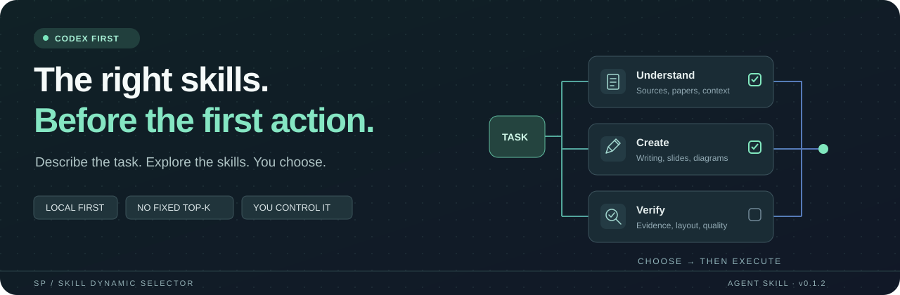

<div align="center">

# 🧭 SP_skill-dynamic_selector

### The right skills, before the first action.

**Describe your task → review likely skills → choose → execute.**

[简体中文](README.md) · English

[](SKILL.md)
[](#quick-start)
[](#boundaries)
[](scripts/inventory.py)
[](https://github.com/Stephen-studying/SP_skill-dynamic_selector/actions/workflows/tests.yml)
[](LICENSE)

</div>



## Why it exists

As a local skill collection grows, agents may overlook a specialist and start working with a generic workflow. Users should not need to memorize skill names to make those capabilities available.

Attach **skill-selector** to an ordinary task. It lists the locally available skills likely to help across the main and supporting steps, explains their roles and alternatives, and waits for your selection. You do not need to ask it to recommend skills.

## What it does

| Capability | Behavior |
| --- | --- |
| Task preflight | Selecting this skill starts the selection step before substantive work |
| No fixed candidate count | Covers likely main, supporting, alternative, and conditional skills |
| Stage-aware choices | Matches the requested inputs, outputs, stage, and constraints |
| Host-aware inventory | Prefers the active session catalog, including plugin namespaces |
| User selection | Loads the selected skill instructions before execution |
| Optional local helper | Standard-library inventory with Chinese and English lexical retrieval |

## Quick start

Select the skill in Codex, or invoke it by name:

```text
$skill-selector Turn this engineering paper into an editable seminar deck, with a method diagram and an explanation of the key figures.
```

The agent first lists the likely reading, presentation, diagram, and supporting skills. Overlapping deck-making routes are marked as alternatives. It explains which steps a comprehensive skill already covers and which supporting skills add value.

Reply with a combination of numbers, skill names, or the suggested combination. Only then does execution begin. Ordinary instructions such as “please do it” do not bypass selection. An explicit request to skip the selection step is respected.

The candidate set changes with your task and installed skills. It is neither a fixed top-three list nor a dump of every installed skill.

## Install

Download `skill-selector-v0.1.2.zip` from [dist/](dist/), extract its top-level `skill-selector` folder, and place it in a supported skill directory.

For a fresh Codex user installation:

```bash
git clone https://github.com/Stephen-studying/SP_skill-dynamic_selector.git ~/.agents/skills/skill-selector
```

Windows PowerShell:

```powershell
git clone https://github.com/Stephen-studying/SP_skill-dynamic_selector.git "$env:USERPROFILE\.agents\skills\skill-selector"
```

Repository name: `SP_skill-dynamic_selector`. Skill folder and invocation name: **`skill-selector`**. Use a destination that does not already exist. Check the host skill list after installation; refresh or start a new session if needed.

The same portable folder can be placed in another agent's supported skill directory. Invocation syntax, discovery paths, and connector availability depend on that host. See [platform notes](references/platforms.md) and the official [Codex skill documentation](https://learn.chatgpt.com/docs/build-skills).

## Compatibility

Codex is the primary target. The standard `SKILL.md` instructions do not depend on a vendor-specific skill-call tool. Claude Code and Gemini directory presets are provided, but these clients have not been tested end to end.

Python 3.11+ is needed only for the optional inventory helper. The instruction workflow can use the active catalog and host file tools without Python. No API key, third-party Python dependency, vector database, or separate paid model is required by the helper. Semantic decisions are made by the current agent.

## Boundaries

- The inventory helper makes no network calls and maintains no remote index. Metadata used by the current agent is processed under that host's own privacy settings. The selector does not install skills, enable plugins, or change global rules.
- Files found on disk are marked `disk_only`; they are not assumed to be enabled or callable.
- Selected downstream skills may need network access, connectors, or other tools under the original task authorization and host permissions.
- The selection step applies when this skill is invoked. It does not intercept every host request or run as a background daemon.
- No universal routing accuracy is claimed. Lexical scores assist retrieval; they are not success probabilities.

## Development

```bash
python -m unittest discover -s tests -v
python scripts/package.py --output dist/skill-selector-v0.1.2.zip
```

Tests cover metadata formats, Unicode, Chinese retrieval, same-name skills from different sources, disabled Codex entries, project boundaries, scan limits, and read-only behavior. Symbolic-link tests may be skipped on systems without creation privileges. Script tests do not prove the agent's recommendation quality or a completed multi-turn task.

The ZIP contains only `SKILL.md`, `agents/openai.yaml`, `scripts/inventory.py`, `references/platforms.md`, and `LICENSE`. Repository documentation, tests, development caches, and local inventories are excluded.

## Acknowledgments and license

Independently authored for this workflow. Initial research considered [pcx-wave/skill-router](https://github.com/pcx-wave/skill-router), [MMStudioCreations/skill-router](https://github.com/MMStudioCreations/skill-router), and the Codex skill format. Their implementations were not copied.

Original code, instructions, and vector artwork are licensed under [MIT](LICENSE). Other skills and third-party products retain their own licenses.
