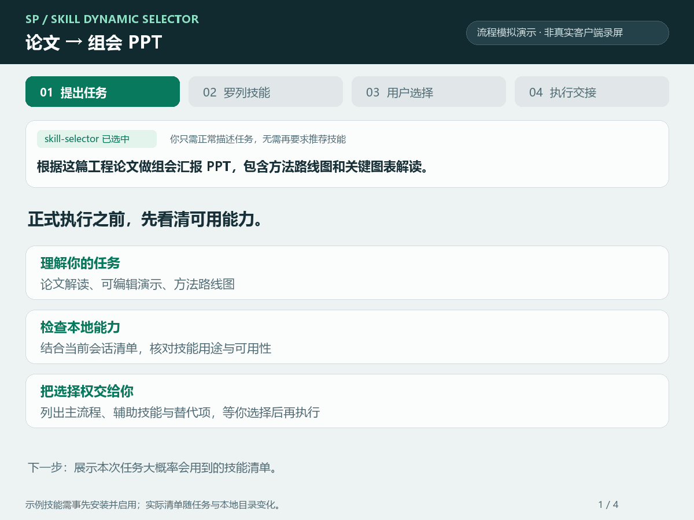
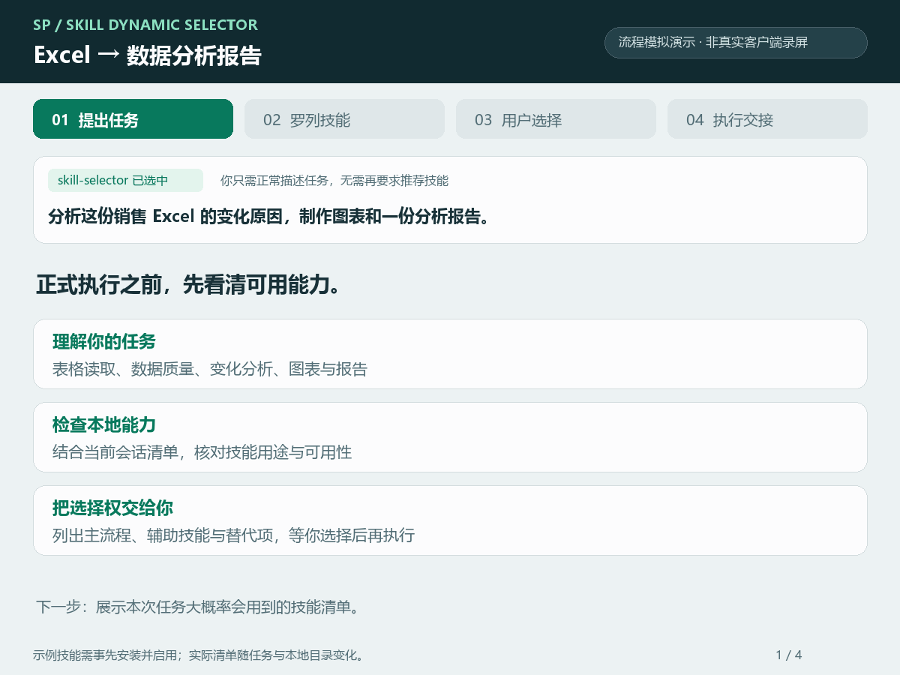
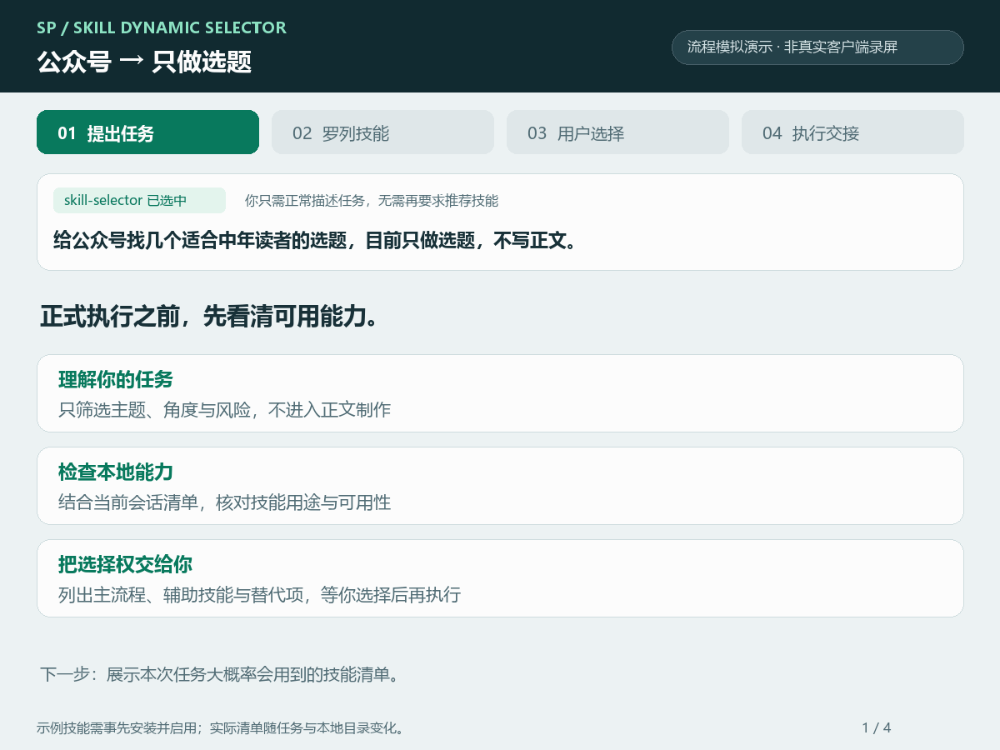

# 案例演示

这组案例演示 `skill-selector` 的交互过程，不是实际客户端录屏，不包含已完成任务的结果或性能评测。所有技能名称均为示例候选；是否可执行仍需以用户当前安装、启用的技能和宿主工具为准。

每个案例都有四个画面：提出普通任务、罗列大概率会用到的技能、接收用户选择、准备按已选路线交接执行。数量随任务变化，不固定展示前几个，也不为了数量添加无关环节。

## 案例一：论文汇报

**任务：** 根据工程论文制作组会 PPT，包含方法路线图和关键图表解读。



七个候选包含源材料读取、精读辅助、不同制稿路线、方法图和有条件的图表重绘。用户选择 `3+6，需要时再用1` 后，交接到学术汇报和技术路线图技能，PDF 读取作为按需能力。

图表解读不自动等同于重绘。`nature-figure` 在本例中明确标为有原始数据且需要重绘时才使用，不列为所有论文汇报的必需项。

[静态清单](../assets/demos/academic-preview.png) · [交接画面](../assets/demos/academic-handoff.png)

## 案例二：Excel 数据分析

**任务：** 分析销售 Excel 的变化原因，制作图表和分析报告。



六个候选分别说明工作簿处理、数据质量、业务分析、指标诊断、定量制图和报告组织。用户选择 `1+2+4+5+6`，并要求先检查数据质量，再分析变化原因。

这些候选之间可能有覆盖关系；演示展示用户如何选择，而不是声称所有任务都必须采用相同组合。这里没有读取任何真实销售数据，也没有生成分析结论。

[静态清单](../assets/demos/data-preview.png) · [交接画面](../assets/demos/data-handoff.png)

## 案例三：公众号只做选题

**任务：** 给公众号找几个适合中年读者的选题，目前只做选题，不写正文。



本例只列三个相关入口，并说明专用选题入口和综合入口的区别。用户选中 `wewrite-topic` 后，交接仍保留“只给选题、角度和风险”的约束，不扩展为正文、配图、排版或发布。

[静态清单](../assets/demos/topics-preview.png) · [交接画面](../assets/demos/topics-handoff.png)

## 重新生成演示

案例文本与选择保存在 [cases.json](cases.json)。视觉由 [render_demos.py](../scripts/render_demos.py) 生成，采用原创绘制界面，不依赖真实账号、浏览器或外部网络。

开发环境需 Pillow 和覆盖中文字符的字体。Windows 默认尝试 Microsoft YaHei；Linux 默认尝试 Noto Sans CJK。也可显式传入字体路径：

```bash
python scripts/render_demos.py
python scripts/render_demos.py --font /path/to/CJK-font.ttf --font-bold /path/to/CJK-bold.ttf
```

每个 GIF 是 1200×900、4 帧、18 秒循环。`*-preview.png` 是完整候选清单，`*-handoff.png` 是交接画面，便于不播放动图时查看。生成器检查文字宽度和画布边界；发布前仍需目视检查布局与内容。

案例脚本、Pillow、字体与视觉文件均不是技能的运行依赖，不进入分发 ZIP。字体文件没有随项目分发，其他技能和产品各遵循其自身许可。
